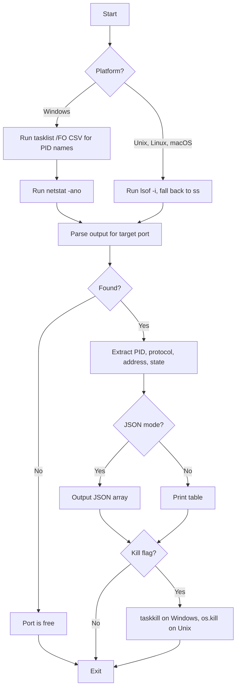

# PortCheck

Find which process is holding a given port. No third-party dependencies required.

## Usage

```bash
python portcheck.py PORT [--kill] [--json]
```

## Options

- `PORT` — The port number to check (1-65535)
- `--kill` — Terminate the process(es) using the port
- `--json` — Output results as JSON

## Examples

```bash
# Check if port 8080 is in use
python portcheck.py 8080

# Kill the process using port 3000
python portcheck.py 3000 --kill

# Get JSON output
python portcheck.py 8080 --json
```

## Features

- **Cross-platform**: Works on both Windows and Unix-like systems (Linux, macOS)
- **No dependencies**: Uses only Python standard library modules
- **Auto-detect platform**: Automatically uses appropriate system commands
- **Multiple output formats**: Tabular or JSON output
- **Process killing**: Terminate processes using the port with `--kill`

## Output Format

### Default (tabular)
```
PID        NAME                    PROTO     STATE        ADDRESS
1234       python.exe              TCP       LISTENING    0.0.0.0:8080
```

### JSON mode (`--json`)
```json
[
  {
    "pid": 1234,
    "name": "python.exe",
    "protocol": "TCP",
    "address": "0.0.0.0:8080",
    "state": "LISTENING"
  }
]
```

## How It Works



### Process Flow:

1. **Platform Detection** - Detects if running on Windows or Unix-like system
2. **Process ID Resolution** - Different methods per platform:
   - **Windows**: Uses `tasklist /FO CSV` to build PID→name mapping, then `netstat -ano`
   - **Unix**: Primarily uses `lsof -i:{port}`, falls back to `ss -Hlntup`
3. **Port Matching** - Filters network connections for the specified port
4. **Result Parsing** - Extracts PID, process name, protocol, address, and TCP state
5. **Output Generation** - Formats results as either table or JSON
6. **Kill Operation** - If `--kill` flag is set:
   - Windows: Uses `taskkill /F /PID`
   - Unix: Uses `os.kill()` with signal 9

## License

MIT
